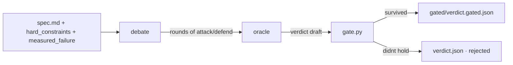

<div align="right">

[](LICENSE)
[](https://github.com/toxicwind/antilogos)
[](https://python.org)
[](https://ranch.localhost)

</div>

# 🗣️ antilogos (ἀντίλογος)

**Counter-argument to the first answer.** An adversarial verification engine:
multiple models debate a candidate solution over rounds, an oracle weighs the
arguments, and a gate only lets a **verdict that survives the debate** ship.
Budgeted, lane-routed, honest.

## Why you should care

Single-shot answers carry a silent single-answer bias. Antilogos forces a
**contest of arguments**: debaters attack and defend under a budget, the oracle
weighs the counter-arguments, and the gate refuses anything that didn't hold up.
It turns "is this right?" into "what survived?"

## Features

- **Debate rounds** — models argue for/against a candidate over N rounds with a per-lane budget.
- **Oracle verdict** — an oracle weighs the debate and produces a verdict, not just a score.
- **Gate** — `bin/gate.py` only ships a verdict that survived; gated/ungated verdicts are audit-trailed.
- **Lane routing** — multi-model lanes (`lanes "url|model,..."`) with a router; `lane-budget`/budget caps keep costs honest.
- **Hard constraints + measured failures** — task lays out `hard_constraints.md` and `measured_failure.md`; debaters must respect them.
- **Full audit trail** — per-run transcripts, candidate JSONs, gated sandboxes, judge-raw + verdict JSON per verdict.

## How it works



## Quick start

```bash
cd antilogos
bin/debate --task tasks/token-bucket --candidates candidates/*.json --rounds 2
bin/debate-run --task tasks/toposort --lanes "url|model" --out runs/debate-1
bin/gate.py --verdict verdict-draft.json --task tasks/token-bucket
```

## Architecture

```
antilogos/
├── bin/
│   ├── debate          # CLI: run a debate over candidates (rounds, lanes, budgets)
│   ├── debate-run      # orchestrates an E2E debate + verdict
│   ├── oracle.py       # the oracle — weighs the arguments to a verdict
│   ├── gate.py         # the gate — only ships a verdict that survived
│   ├── brief.py        # builds the debate brief
│   └── brief-code.py   # brief a code file
├── prompts/            # debater.md, rebuttal.md, oracle-v1.md
├── tasks/              # task spec + pytest acceptance tests
├── runs/               # per-race transcripts (json + md)
├── verdicts/           # per-debate: candidates, gated sandboxes, judge-raw, verdict JSON
├── audit/              # FINDINGS + audit harness
└── e2e/                # end-to-end debate + verdict pipeline
```

## The gate

`gate.py` is the choke point: a draft verdict that fails the debate, the hard
constraints, or the acceptance tests is recorded as rejected and never ships.
Every gate decision lands a `verdict-for-gate.json` + `verdict.gated.json` so
both the human and the fleet can see exactly why.

## License & security

MIT — debaters are real model lanes over the router; budgets and lane caps keep
spend bounded. Secrets stay on the box, never in the repo.